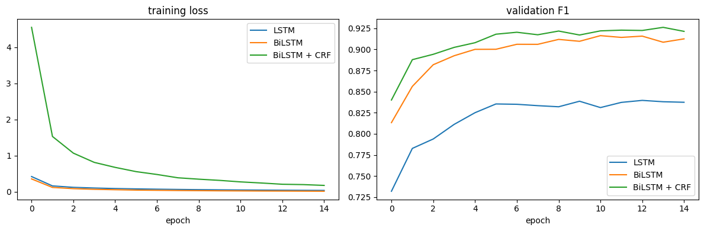
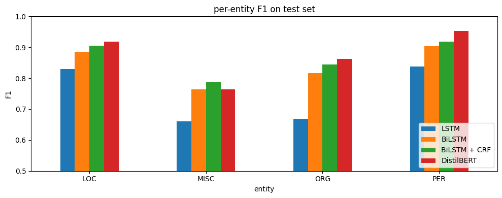
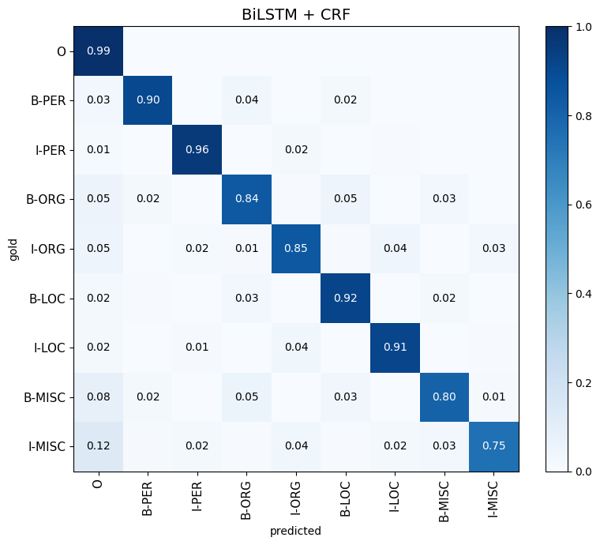
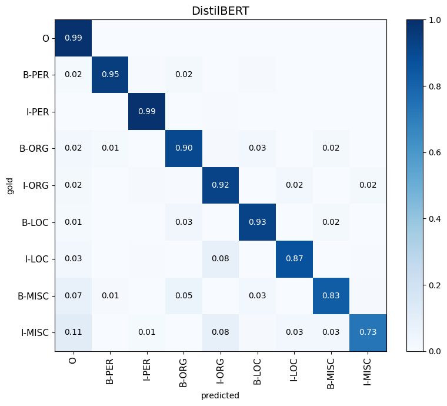
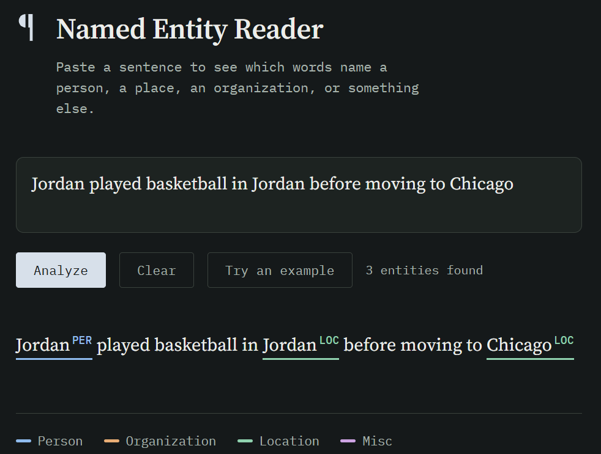

# Named Entity Recognition System


A sequence-labeling system that identifies and classifies named entities — people, organizations, locations, and miscellaneous proper nouns — in free text. Four architectures are trained and compared from scratch and fine-tuned, then the best model is served through a FastAPI backend with a small web frontend.

🤗 **Fine-tuned model on the Hub:** [Ahmed-Tarek0/ner-distilbert-conll2003](https://huggingface.co/Ahmed-Tarek0/ner-distilbert-conll2003)

---

## Table of contents

- [Overview](#overview)
- [Dataset](#dataset)
- [Approach](#approach)
- [Results](#results)
- [Where the CRF helps](#where-the-crf-helps)
- [A real limitation: unfamiliar names](#a-real-limitation-unfamiliar-names)
- [Deployment](#deployment)
- [Project structure](#project-structure)
- [Running it yourself](#running-it-yourself)
- [Demo](#demo)

---

## Overview

This project builds an end-to-end NLP pipeline for Named Entity Recognition (NER):

- preprocessing and exploring the **CoNLL-2003** dataset
- handling out-of-vocabulary words with pretrained **GloVe** embeddings and a character-level CNN
- training three sequence models from scratch: **LSTM**, **BiLSTM**, and **BiLSTM + CRF**
- fine-tuning a pretrained transformer: **DistilBERT**
- evaluating every model with **seqeval** (per-entity precision/recall/F1) and confusion matrices
- deploying the best model behind a **FastAPI** backend with a small web UI, containerized with **Docker**

## Dataset

[CoNLL-2003](https://huggingface.co/datasets/eriktks/conll2003) — news-wire text tagged with the IOB2 scheme across four entity types:

| Tag | Meaning |
|---|---|
| `PER` | Person |
| `ORG` | Organization |
| `LOC` | Location |
| `MISC` | Miscellaneous (events, nationalities, titles, etc.) |

## Approach

| Model | Type | Notes |
|---|---|---|
| LSTM | from scratch | one-directional, GloVe + char-CNN embeddings |
| BiLSTM | from scratch | adds backward context |
| BiLSTM + CRF | from scratch | adds a CRF decoding layer on top |
| DistilBERT | fine-tuned | `distilbert-base-cased`, HuggingFace `Trainer` |

All four models share the same train/validation/test split and are evaluated with the same `seqeval` metrics for a fair comparison.

## Results

Overall micro-F1 on the test set:

| Model | F1 |
|---|---|
| LSTM | 0.7639 |
| BiLSTM | 0.8558 |
| BiLSTM + CRF | 0.8761 |
| **DistilBERT** | **0.8920** |





DistilBERT scores highest overall, especially on `PER` (0.953) and `ORG` (0.863), thanks to its pretrained contextual representations. Interestingly, BiLSTM + CRF still edges it out on `MISC` (0.787 vs 0.764) — a structured decoding layer helps with the least consistent entity type.

### Confusion matrices





## Where the CRF helps

A plain BiLSTM tags every token independently, so it can produce sequences that don't make sense — like an `I-PER` tag with no `B-PER` before it, or splitting one name across two entity types. The CRF layer learns transition scores between tags and decodes the whole sequence at once (Viterbi), which keeps multi-word entities consistent.

| | Invalid `I-` transitions | Boundary errors (right type, wrong span) |
|---|---|---|
| LSTM | 428 | 428 |
| BiLSTM | 128 | 170 |
| BiLSTM + CRF | **5** | **85** |
| DistilBERT | 97 | 141 |

In practice this means BiLSTM + CRF rarely breaks a name into two different entity types the way the plain BiLSTM sometimes does — and it even edges out the fine-tuned transformer here, since DistilBERT has no structured decoding layer of its own.

## A real limitation: unfamiliar names

Testing the deployed model with names outside CoNLL-2003's mostly Western news-wire training data exposes a real limitation: the Egyptian football club **"Al Ahly"** gets misclassified as a `PER` instead of an `ORG`, while a more familiar name like "Zamalek" is tagged correctly. The model falls back to surface-level patterns (the word *looks* like a name) when it hasn't seen anything similar in training — a good reminder that NER models inherit the cultural and geographic bias of their training data.

## Deployment

The fine-tuned DistilBERT model is served through a small, layered FastAPI backend with a static frontend:

```
deployment/
  backend/
    app/
      main.py          # wires routes + static frontend together
      config.py         # paths and settings
      schemas.py         # request/response models (Pydantic)
      ner_service.py      # loads the model once, runs inference
      routers/
        ner.py            # POST /api/predict, GET /api/health
  frontend/
    index.html / style.css / script.js
```

- `POST /api/predict` takes `{ "text": "..." }` and returns the entities found (text, label, start, end, score)
- the frontend shows the entities **inline**, underlined in place in the original sentence, color-coded by type
- the backend and frontend are served from the same FastAPI app — one command runs both
- a `Dockerfile` and `docker-compose.yml` are included for containerized deployment

## Project structure

```
.
├── NER_System.ipynb          # full pipeline: data, training, evaluation
├── assets/                   # charts and screenshots used in this README
└── deployment/
    ├── Dockerfile
    ├── docker-compose.yml
    ├── backend/               # FastAPI app (see above)
    └── frontend/              # static UI served by the backend
```

## Running it yourself

### 1. The notebook

Open `NER_System.ipynb` in Colab or Kaggle (GPU recommended) and run all cells top to bottom. It trains all four models, evaluates them, and saves the fine-tuned transformer to `ner_distilbert/`.

### 2. The API, locally

```bash
# put the model folder from the notebook here first:
# deployment/backend/ner_distilbert/

cd deployment/backend
pip install -r requirements.txt
uvicorn app.main:app --reload
```

Open **http://127.0.0.1:8000**. API docs: **http://127.0.0.1:8000/docs**

### 3. With Docker

```bash
cd deployment
docker build -t ner-reader .
docker run -p 8000:8000 ner-reader
```

## Demo




## License

This project is licensed under the MIT License — see the [LICENSE](LICENSE) file for details.

## Author

**Ahmed Tarek** — [GitHub](https://github.com/Ahmed-Tarek0)